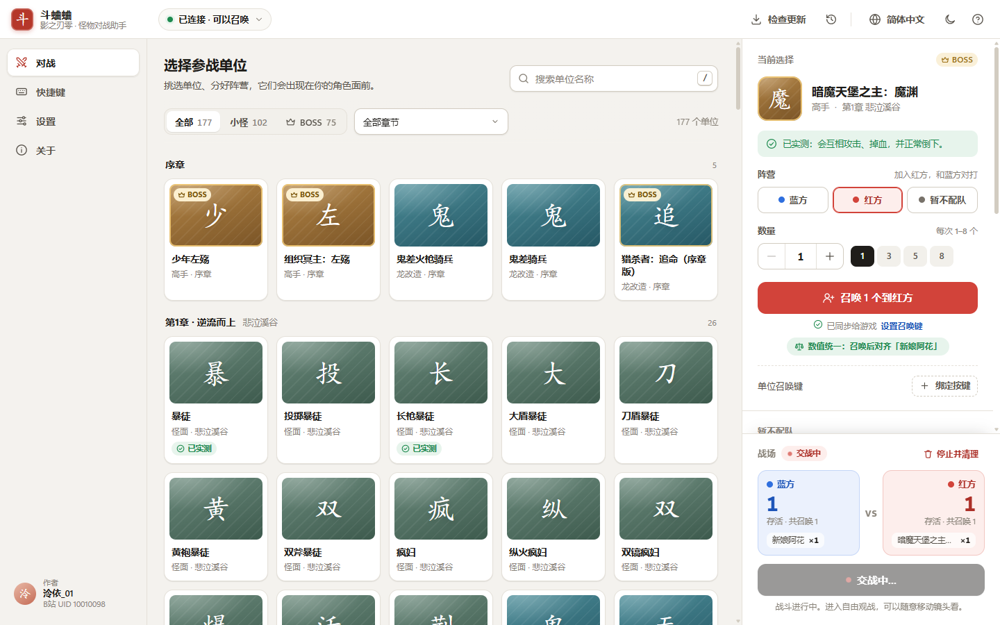
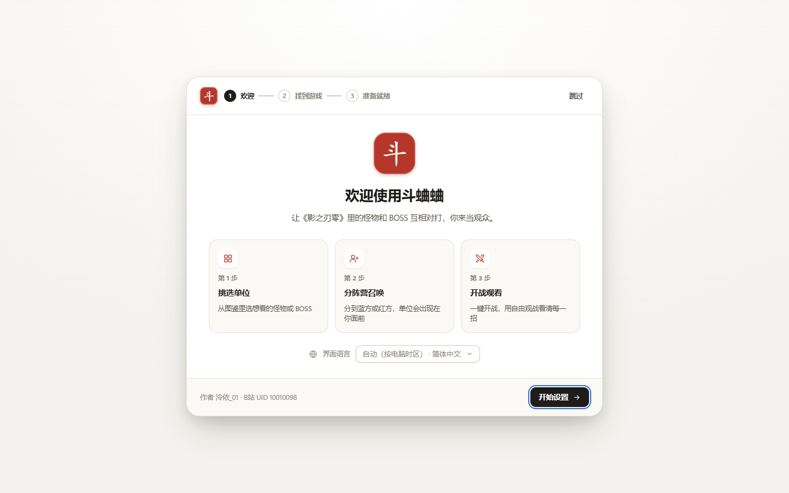
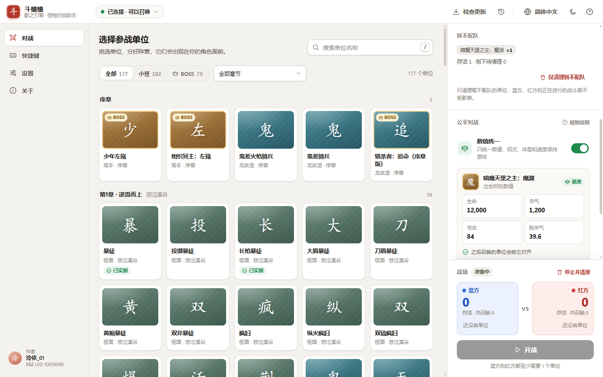
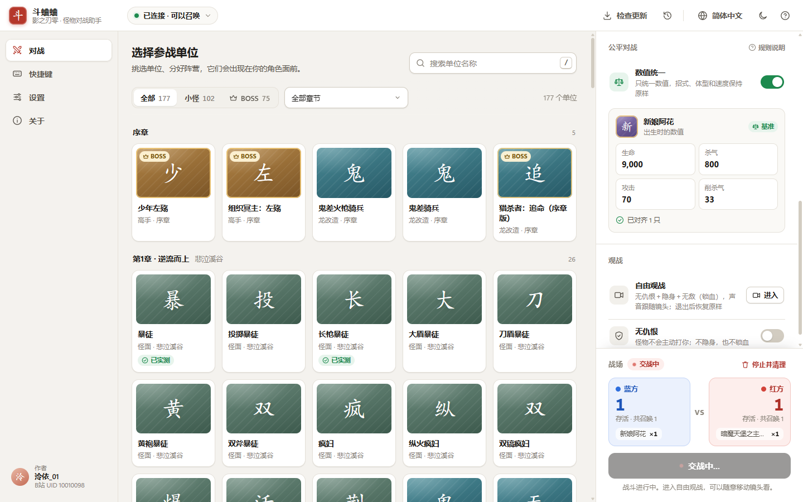
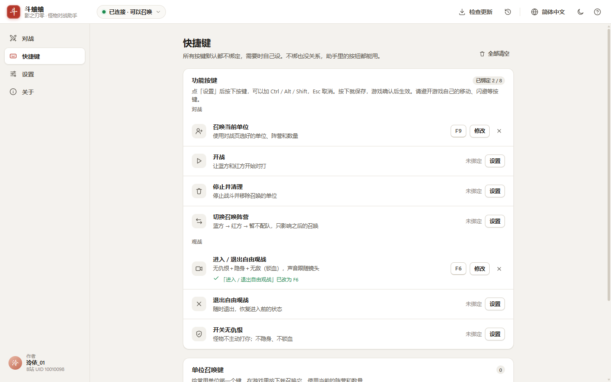
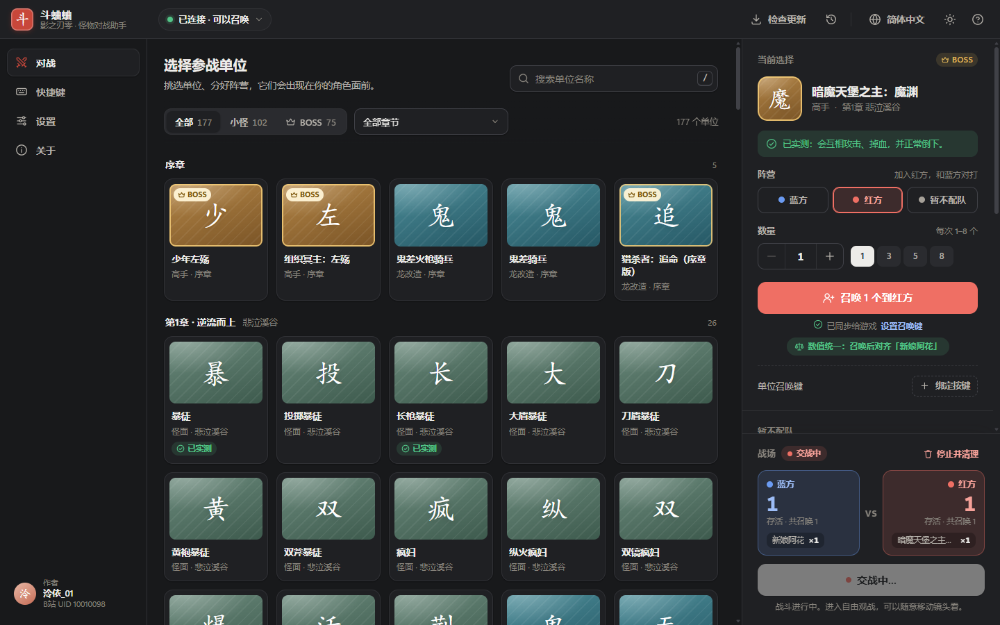

<div align="center">

# 斗蛐蛐 · 影之刃零怪物对战助手

**Phantom Gladiator — NPC battles for *Phantom Blade Zero***

让《影之刃零》里的怪物和 BOSS 互相开打：选怪、分阵营、一键开战，再用自由视角从任意角度观战。

[下载最新版](https://github.com/LingYi-Liang/PhantomGladiator/releases/latest) · [使用说明](#三步开始) · [常见问题](#常见问题) · [English](#english)

作者：**泠依_01** · B站 UID **10010098** · [B站主页](https://space.bilibili.com/10010098)

</div>



---

## 这是什么

《影之刃零》里的敌人默认只会打玩家。这个项目由两部分组成：

- **游戏内模组**（UE4SS Lua）：在你面前召唤游戏里原有的怪物，把它们分成蓝方、红方，改写它们的仇恨和阵营关系，让它们按游戏原生的招式、受击和死亡逻辑真打起来。
- **桌面助手**（本仓库发布的 `PhantomGladiator.exe`）：给模组配了一个小白也能用的界面。第一次打开会自动找到游戏、一键装好所需组件，之后点点鼠标就能选怪、召唤、开战、观战。

模组只在游戏运行时改内存里的对象，**不修改游戏文件、资源或存档**。关掉游戏，召唤的单位和改动都会消失。

## 下载

到 **[Releases](https://github.com/LingYi-Liang/PhantomGladiator/releases/latest)** 下载 `PhantomGladiator-<版本>-win64.zip`（约 20 MB），旁边的 `.sha256` 文件可用来校验下载是否完整。

- 国内网络打不开 GitHub 时，可以借助常见的 GitHub 下载加速站下载同一个文件，下载后对照 `.sha256` 校验即可。
- 装好以后，助手里的「检查更新」会自动挑选国内可用的线路，下载后自动校验 SHA-256，不需要再手动找下载地址。

## 三步开始

1. **解压**：把整个压缩包解压到任意文件夹（不要在压缩包里直接双击）。
2. **打开助手**：双击 `PhantomGladiator.exe`。新手引导会：
   - 自动在 Steam 库里找到《影之刃零》（找不到可以手动选择文件夹）；
   - 检查并一键安装需要的组件：模组加载器 UE4SS、游戏适配文件、斗蛐蛐模组。
3. **开打**：启动游戏、读取存档进入地图，等助手右上角变成绿色「已连接 · 可以召唤」。在左边选一个怪，召唤到蓝方；再选一个召唤到红方；点「开战」。

> 第一次运行时 Windows 可能弹出「Windows 已保护你的电脑」：点「更多信息」→「仍要运行」。助手没有购买代码签名证书，这是未签名程序的正常提示。



## 功能一览

### 选怪与召唤
- **图鉴选怪**：内置游戏原生图鉴里的 177 个角色（其中 75 个 BOSS 及其形态），按章节和地图分组，支持搜索、按小怪/BOSS 筛选。
- **分阵营召唤**：蓝方、红方，每次 1–8 只，场上总数不设上限。
- **快捷操作**：鼠标移到卡片上直接「+蓝方 / +红方」；键盘选中卡片后按 `B` / `R` / `N` 分别召唤到蓝方、红方、暂不配队，`Ctrl+Enter` 召唤当前选择。
- **单位召唤键**：给常用的怪绑一个键，在游戏里按下就召唤它。每个键记住自己的阵营和数量：在对战页选中这个怪，切换上面的阵营或数量，它的键就跟着改，不同的怪可以各站一边。

### 对战
- **一键开战**：蓝红双方各至少 1 只即可开战，交战中继续召唤的单位会自动加入战斗。
- **战场计数**：实时显示双方存活数、倒下待清理数，以及暂时读不到状态的单位。
- **胜负与再来一局**：一方全灭后显示胜者；「再来一局」会按上一局的阵容重新召唤并开战。
- **停止并清理**：移除所有由助手召唤的单位并恢复战斗中改动过的关系，游戏原有的怪物不受影响。

### 暂不配队：自己练 BOSS
选「暂不配队」召唤的单位不加入蓝红任何一方，像游戏里的普通敌人一样会来打你，适合反复练同一个 BOSS。它们有独立的存活计数和「仅清理暂不配队」按钮，不影响正在进行的蓝红对战；全部倒下后点「再刷一次」就能立刻再来一只。



### 公平对战 · 数值统一
开启后，第一只召唤的单位成为「基准」，之后召唤的单位会把生命和杀气上限、攻击、削杀气、攻防倍率统一成基准的数值（共 107 项战斗属性，满生命满杀气入场）。招式、体型、速度和 AI 不变，适合看「同样的数值下谁更会打」。



### 召唤难度
不用改游戏难度，也能召唤不同难度的怪。在对战页右侧的「召唤难度」里选择：跟随游戏、入阵者、破局者、逆天者或六十六天。之后召唤的单位就按这一档生成：
- 血量、攻击、杀气等数值；
- AI 的难度判断，例如技能池里逆天者才开放的招式。

你自己、地图上原有的怪，以及存档里的游戏难度都不会变。六十六天和逆天者对怪物来说完全一样，区别只在玩家的死亡次数上限。少数以整个世界为对象的难度查询，以及游戏底层直接读取难度的部分（例如 BOSS 召唤小怪的血量门槛），仍按游戏本身的难度。

### 观战
- **自由观战**：无仇恨 + 隐身 + 无敌（锁血），声音跟随镜头。用 WASD 移动、Q / E 升降、Shift 加速、鼠标转向，退出后恢复进入前的状态。可以在助手里点「进入」，也可以绑定快捷键。
- **无仇恨**：只让怪物不主动打你，不隐身也不锁血，适合在普通视角下观战。

### 快捷键
8 个功能键（召唤、开战、停止并清理、切换召唤阵营、进入 / 退出自由观战、退出自由观战、开关无仇恨、扫描目录）**默认全部不绑定**，需要时在「快捷键」页自己设置，可组合 Ctrl / Alt / Shift。同一个键只能分给一个功能或单位，冲突和系统保留键会直接提示。



### 其他
- **六种语言**：简体中文、English、日本語、Français、Deutsch、Español，按电脑时区自动选择，也可以手动切换。
- **浅色 / 深色主题**。
- **操作记录**：每条操作都等游戏回执后才显示成功；没有回执就不算成功，也不会自动重发。
- **诊断报告**：设置 → 高级里一键把日志打包到桌面，方便反馈问题。



## 系统要求与兼容性

| 项目 | 要求 |
| --- | --- |
| 系统 | Windows 10 / 11，64 位 |
| 运行库 | Microsoft Edge WebView2（Windows 10/11 一般自带；缺少时助手会给出微软官方下载链接）、.NET Framework 4.8（系统自带） |
| 游戏 | Steam 版《影之刃零》，已测试 build **26266538**；其他版本未经测试 |
| 模组加载器 | UE4SS 3.0.1（随包附带；游戏里已经装了 UE4SS 时不会覆盖） |

## 已验证的范围

为了不误导，这里如实写明哪些经过了实机验证：

- 已实测：普通持刀暴徒互斗；新娘阿花与暗魔天堡之主魔渊对战；数值统一（两轮 109 项数值读回全部一致）；BOSS 常驻血条和生命数字；自由观战的隐身、锁血、声音跟随与退出恢复；暂不配队单位的召唤与存活计数；全部 8 个功能键的保存与生效回执；单位召唤键按各自的阵营召唤。
- 召唤难度已实测：游戏本身保持入阵者，阿花和魔渊按逆天者、六十六天召唤，数值读回与游戏配置表一致（攻击约 1.43 倍、杀气攻击约 3 倍、杀气上限 2 倍；这两个 BOSS 的血量在各难度相同）。AI 的两类难度检查（行为树分支、技能池条件）都按所选难度回答，地图上的其他怪和整个世界仍是游戏难度。
- 可以尝试、但不保证：图鉴里的其他单位都能召唤，但不一定都能正常对打。个别单位有天生机制（例如机灵鬼天生无敌/穿透），不会因为召唤而改变。
- 已知情况：清理时如果还有单位活着，游戏端第一遍会留下一条恢复记录。助手会在同一次点击里自动补做第二遍；在游戏里直接按「停止并清理」快捷键时，目前需要按两次。

## 常见问题

<details>
<summary><b>右上角一直是「游戏未启动」或「未进入地图」</b></summary>

需要先启动游戏并读取存档进入地图。如果游戏已经在运行，但组件是刚装好的，请重启一次游戏让模组加载。设置 → 游戏里可以看到各组件是否「已就绪」。
</details>

<details>
<summary><b>助手找不到游戏</b></summary>

在新手引导或设置 → 游戏里点「选择文件夹」，选《影之刃零》的安装目录（里面有 <code>platform\steam\PBZ.exe</code>）。
</details>

<details>
<summary><b>提示「另一个斗蛐蛐助手或开发面板正在使用这份游戏数据」</b></summary>

同一时间只能有一个助手连接游戏。请关掉其他已打开的斗蛐蛐助手（或开发用的网页面板），再点「重试」。
</details>

<details>
<summary><b>召唤失败 / 召唤的怪不动</b></summary>

部分单位在当前地图无法生成，或天生不参与战斗。可以先试「暴徒」这类已实测的单位；失败原因会显示在通知和「操作记录」里。
</details>

<details>
<summary><b>会影响存档或游戏文件吗？</b></summary>

模组只在游戏运行时改内存中的对象，不写游戏资源和存档。安装时只会在游戏目录的 <code>platform\steam</code> 下放入 UE4SS（<code>dwmapi.dll</code> 和 <code>ue4ss</code> 文件夹）以及本模组。使用任何第三方模组都有一定风险，请自行判断。
</details>

<details>
<summary><b>怎么卸载？</b></summary>

- 助手：直接删除解压出来的文件夹；助手的设置和缓存在 <code>%LOCALAPPDATA%\PhantomGladiator</code>，也可以一起删。
- 游戏里的组件：删除游戏目录 <code>platform\steam\ue4ss\Mods\PhantomGladiator</code> 即可停用本模组；如果不再需要 UE4SS，再删除 <code>platform\steam\dwmapi.dll</code> 和 <code>platform\steam\ue4ss</code>。
</details>

<details>
<summary><b>遇到问题怎么反馈？</b></summary>

到 <a href="https://github.com/LingYi-Liang/PhantomGladiator/issues">Issues</a> 描述你做了什么、看到了什么，并附上设置 → 高级 →「导出诊断报告」生成在桌面上的压缩包。
</details>

## 工作原理

```
助手窗口（WebView2）
   │  同源 HTTP，仅本机 127.0.0.1
本地后台（panel/backend.py，随包附带精简 Python）
   │  文件桥：Runtime/inbox.tsv → ack.tsv，status.tsv 每 250 ms 刷新
游戏内模组（Mods/PhantomGladiator，UE4SS Lua）
   │  调用游戏原生的召唤、阵营、仇恨与 AI 接口
《影之刃零》
```

- 每条操作都要等游戏写回执（ack）才算完成，没有回执就标为「结果未确认」，不会自动重发，避免重复召唤。
- 召唤的每个单位都登记在模组里，清理只移除自己登记的单位，并把战斗中改过的关系逐条恢复、逐条读回确认。
- 助手不调用任何游戏接口，也不联网收集数据；联网只用于你主动或自动检查更新。

## 给开发者

```
Mods/PhantomGladiator/Scripts/   游戏内模组（Lua，入口 main.lua，配置 config.lua）
GameConfig/                      本作的 UE4SS 签名与内存布局适配
panel/backend.py                 本地后台：校验指令、文件桥、读取游戏状态（仅标准库）
panel/prototype/                 助手界面；mock-runtime.js 是可离线点击的原型，real-runtime.js 连接真实后台
desktop/PhantomGladiator.cs      原生窗口：WebView2、启动后台、安装组件、启动游戏、更新
tools/package/build.py           打包脚本：生成 dist/PhantomGladiator-<版本>-win64.zip
panel/static/                    开发用的旧网页面板
docs/                            开发记录与逆向笔记，入口 docs/HANDOFF.md
```

**打包**：准备好 `build.py` 开头列出的三个第三方文件（Python 嵌入版、WebView2 SDK、UE4SS 3.0.1，脚本会核对 SHA-256），然后运行：

```powershell
python tools/package/build.py --deps <下载目录> --seed <游戏的 Runtime 目录>
```

`--seed` 提供随包附带的精简单位目录（由模组从游戏注册表导出）。编译原生窗口使用 Windows 自带的 .NET Framework 编译器，不需要安装 Visual Studio。

**界面原型**：用任意静态服务器打开 `panel/prototype/index.html`，左下角「原型演示」可以模拟连接状态、召唤失败、清理未完成等各种情况，不需要游戏。

**开发与逆向记录**：从 [docs/HANDOFF.md](docs/HANDOFF.md) 开始读；模组测试流程见 [docs/DEVELOPMENT.md](docs/DEVELOPMENT.md)，实验结论见 [docs/REVERSE_ENGINEERING.md](docs/REVERSE_ENGINEERING.md)。

## 声明

- 本项目是玩家自制的非官方工具，与《影之刃零》开发商 S-GAME（灵游坊）及发行方无关。
- 仓库和发布包不包含任何游戏资源文件。界面里的单位名称来自游戏内图鉴，版权归原权利人所有。
- 使用模组的风险由使用者自行承担。

## 许可

本项目以 [MIT 许可](LICENSE) 发布。发布包附带的第三方组件：

- [UE4SS](https://github.com/UE4SS-RE/RE-UE4SS)：MIT 许可
- [Python 3.11 嵌入版](https://www.python.org/)：PSF 许可
- [Microsoft Edge WebView2 SDK](https://www.nuget.org/packages/Microsoft.Web.WebView2)：见发布包内 `licenses` 文件夹

---

## English

**Phantom Gladiator** makes the monsters and bosses of *Phantom Blade Zero* fight each other. It is a UE4SS Lua mod plus a desktop app: pick units from the game's own codex, summon them to the Blue or Red team, start the fight, and watch from a free camera that keeps your character hidden and invulnerable.

**Get started**

1. Download `PhantomGladiator-<version>-win64.zip` from [Releases](https://github.com/LingYi-Liang/PhantomGladiator/releases/latest) and unzip it.
2. Run `PhantomGladiator.exe`. The first-run guide finds the game in your Steam library and installs UE4SS and the mod in one click.
3. Start the game, load a save, wait for the green "Connected" badge, then summon and fight.

**Features**: 177 codex characters (75 bosses) · Blue / Red / No team (fight a boss yourself) · 1–8 per summon, no total cap · equal stats mode (107 combat attributes matched to a baseline) · summon difficulty: new units play at Wayfarer, Pathbreaker, Hellwalker or Sixty-Six Days (stats and the AI's difficulty checks) while the game, map enemies and your save keep their own difficulty · free camera and no-aggro spectating · all 8 function keys rebindable (none bound by default) · per-unit summon keys that remember their own team and amount · rematch with the last lineup · six UI languages chosen from your time zone · light and dark themes · update checks with mirrors and SHA-256 verification.

**Requirements**: Windows 10/11 64-bit, WebView2 runtime (built in), Steam version of *Phantom Blade Zero* build 26266538 (other builds untested).

The mod only changes objects in memory while the game runs; it never edits game files or saves. This is an unofficial fan project, not affiliated with S-GAME. Released under the [MIT License](LICENSE).
